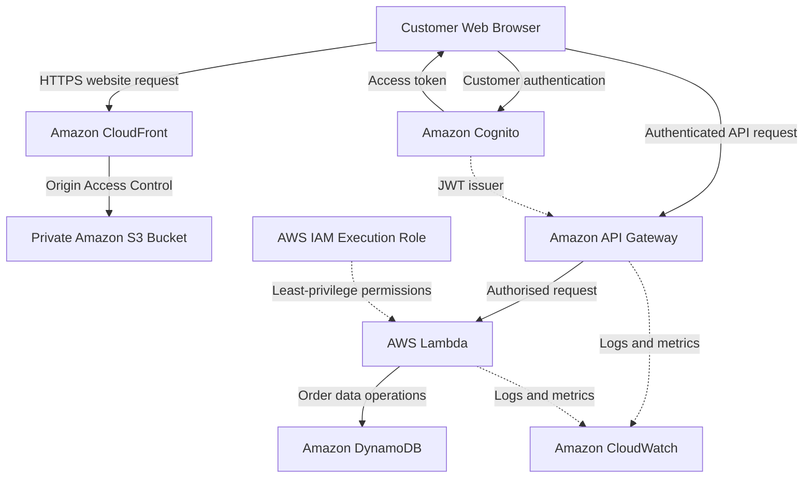

# AWS Solutions Architecture: Secure & Scalable Customer Platform

### Cloud Solutions Engineering | AWS Architecture | Serverless Computing | Security & Reliability

**Project Type:** Cloud Solutions Architecture Case Study

**Client:** Fictional UK-Based Online Retailer

**Cloud Provider:** Amazon Web Services (AWS)

**Proposed Region:** Europe (London) — eu-west-2

**Status:** Architecture Design Completed | November 2026

**Implementation:** Proposed Architecture — Not Deployed to AWS

---

## Executive Summary

This project presents a cloud solutions architecture designed for a growing UK-based online retailer requiring a secure, scalable and reliable customer-facing application.

The business needs to support customer authentication, order submission and order tracking while accommodating fluctuations in demand during promotional periods.

I designed a serverless AWS architecture that uses managed cloud services to reduce infrastructure administration, support variable workloads and introduce appropriate security controls.

The proposed solution combines **Amazon CloudFront, Amazon S3, Amazon Cognito, Amazon API Gateway, AWS Lambda, Amazon DynamoDB and Amazon CloudWatch**.

The outcome is a documented technical architecture, including service selection, identity and access management, security considerations, resilience planning, scalability assessment and architectural trade-offs.

This is a design-focused portfolio project. No production deployment, live performance testing or measured availability is claimed.

## Business Challenge

A growing online retailer needs a technology platform capable of supporting customer activity without relying on manually managed application servers.

The architecture must balance:

- Reliable access to customer-facing services.
- Secure customer authentication and order access.
- Scalability during promotional demand.
- Protection of customer information.
- Operational monitoring and incident investigation.
- Cost-conscious cloud infrastructure.

### Business Requirements

| Requirement | Business Objective |
| --- | --- |
| Secure customer accounts | Protect customer identities and information |
| Order processing | Support customer order submission |
| Order tracking | Allow customers to access their own orders |
| High availability | Reduce service disruption |
| Elastic scalability | Support changing application demand |
| Operational monitoring | Provide visibility into application health |
| Cost optimisation | Align technology expenditure with business usage |

## Proposed AWS Architecture

### Architecture Overview

The solution follows a serverless, multi-tier architecture.

**1. Presentation Layer**

Amazon CloudFront distributes frontend content stored in a private Amazon S3 bucket. Origin Access Control restricts direct access to the S3 origin.

**2. Identity Layer**

Amazon Cognito provides customer authentication and token issuance. API Gateway validates access tokens for protected API endpoints.

**3. Application Layer**

Amazon API Gateway receives customer API requests and invokes AWS Lambda functions responsible for order processing and retrieval.

**4. Data Layer**

Amazon DynamoDB provides persistent storage for customer order records using a data model designed around customer-specific access patterns.

**5. Security and Monitoring**

AWS IAM restricts service permissions, while Amazon CloudWatch provides application logs, operational metrics and monitoring capabilities.

## AWS Technology Decisions

| AWS Service | Purpose | Architecture Justification |
| --- | --- | --- |
| Amazon CloudFront | Content delivery | Efficient delivery and caching of frontend assets |
| Amazon S3 | Frontend hosting | Managed storage without dedicated web servers |
| Amazon Cognito | Customer authentication | Managed identity and token issuance |
| Amazon API Gateway | API management | Managed API routing, JWT authorisation and throttling |
| AWS Lambda | Application processing | Event-driven execution without server administration |
| Amazon DynamoDB | Data storage | Managed database with flexible request capacity |
| AWS IAM | Service authorisation | Least-privilege permissions for application resources |
| Amazon CloudWatch | Monitoring | Centralised application logs and operational metrics |

## Identity & Access Management

The architecture separates **customer identity management** from **AWS resource authorisation**.

### Customer Authentication

Amazon Cognito manages user authentication.

API Gateway validates access tokens before invoking protected application endpoints.

### Resource Authorisation

AWS IAM defines which AWS resources the Lambda execution role can access.

The proposed design follows least-privilege principles, restricting database permissions to the actions required by the application.

Application-level authorisation must also ensure that customers can only retrieve their own order records.

**Security Objective:** Protect customer identities, restrict data access and minimise unnecessary permissions.

## Security & Reliability Considerations

The proposed design incorporates:

- HTTPS communication.
- Customer authentication and API token validation.
- Least-privilege AWS IAM permissions.
- Private S3 origin access.
- Application input validation.
- Customer-level order authorisation.
- CloudWatch logging and monitoring.
- DynamoDB backup and recovery planning.
- Appropriate throttling and failure-handling strategies.

### Availability and Recovery

The design targets 99.9% availability as a preliminary business objective.

AWS managed services provide infrastructure resilience capabilities, but application availability still depends on correct configuration, dependency management and operational procedures.

The architecture uses a single primary AWS Region and does not claim automatic cross-Region disaster recovery.

Specific recovery objectives require business agreement and validation.

## Scalability & Performance

The proposed architecture is evaluated against illustrative customer demand.

| Workload Metric | Planning Assumption |
| --- | --- |
| Daily active customers | 1,000 |
| Average API requests per customer | 10 per day |
| Normal API traffic | 10,000 requests per day |
| Normal monthly traffic | 300,000 requests |
| Promotional demand scenario | Up to 10x normal demand |

Lambda provides managed compute scaling, DynamoDB on-demand capacity supports variable database workloads, and CloudFront caches eligible frontend content.

Actual performance would require load testing, monitoring and validation against the application's service-level objectives.

## Cost Optimisation & Trade-Offs

The project evaluates AWS cost drivers rather than presenting unverified monthly expenditure estimates.

Key considerations include:

- Lambda request volume, memory and execution duration.
- API Gateway request volume.
- DynamoDB read/write activity and data storage.
- Cognito monthly active users and selected features.
- CloudFront requests and data transfer.
- S3 storage and requests.
- CloudWatch logging, metrics and alarms.

### Key Architectural Trade-Offs

| Decision | Advantage | Limitation |
| --- | --- | --- |
| Serverless computing | Reduced server management | Cold starts and variable usage costs |
| DynamoDB | Managed capacity and key-based access | NoSQL modelling constraints |
| Cognito | Managed customer authentication | Identity service configuration and dependency |
| Single AWS Region | Lower initial complexity | No automatic full-Region failover |
| CloudFront + S3 | Efficient frontend delivery | Requires secure origin and caching configuration |

A future implementation should include a validated AWS Pricing Calculator estimate based on actual request sizes, resource configurations and operating requirements.

## Technical Documentation

The full architecture assessment is documented across three deliverables:

| Document | Description |
| --- | --- |
| [01 — Solution Requirements](docs/01-solution-requirements.md) | Business objectives, functional requirements, non-functional requirements and workload assumptions |
| [02 — AWS Architecture](docs/02-aws-architecture.md) | AWS service selection, architecture diagram, request workflow, data design and architecture decisions |
| [03 — Security, Reliability & Costs](docs/03-security-reliability-costs.md) | IAM, security threats, resilience, disaster recovery, monitoring, scalability and cost considerations |

## AWS Well-Architected Principles

The solution was conceptually evaluated against the six AWS Well-Architected pillars:

| Pillar | Architecture Consideration |
| --- | --- |
| Operational Excellence | Monitoring, logging and operational procedures |
| Security | Authentication, authorisation and least privilege |
| Reliability | Managed services, failure handling and recovery planning |
| Performance Efficiency | Serverless scaling and managed database capacity |
| Cost Optimisation | Usage-based cost modelling and financial monitoring |
| Sustainability | Efficient managed services and avoiding unnecessary always-on infrastructure |

This is a conceptual evaluation, not a formal AWS Well-Architected Review.

## Recommendations & Future Implementation

Before production adoption, the proposed solution should undergo:

1. Proof-of-concept implementation.
2. Identity and access security validation.
3. Application and API security testing.
4. Load testing against agreed performance objectives.
5. Backup and recovery testing.
6. Cost validation using AWS Pricing Calculator.
7. Operational monitoring and alerting configuration.

## Skills Demonstrated

| Technical Capability | Project Evidence |
| --- | --- |
| AWS Cloud Architecture | Multi-tier serverless design |
| Solutions Engineering | Business requirements and technology selection |
| Identity & Access Management | Cognito, JWT authorisation and IAM role design |
| Security Architecture | Least privilege, data protection and threat assessment |
| Database Architecture | DynamoDB data modelling and access patterns |
| Reliability Engineering | Failure handling and recovery planning |
| Scalability | Lambda, API Gateway and DynamoDB capacity considerations |
| Cost Optimisation | Cost drivers and architectural trade-offs |
| Technical Documentation | Architecture diagrams and decision records |

## Project Scope

This repository contains a proposed cloud architecture for a fictional business scenario.

The architecture, service configurations, security controls and performance objectives are documented for technical portfolio purposes.

No live AWS deployment, production testing or validated operational performance is claimed.

---

**Project Focus:** AWS Solutions Architecture | Cloud Solutions Engineering | Serverless Architecture | Identity & Access Management | Reliability & Cost Optimisation