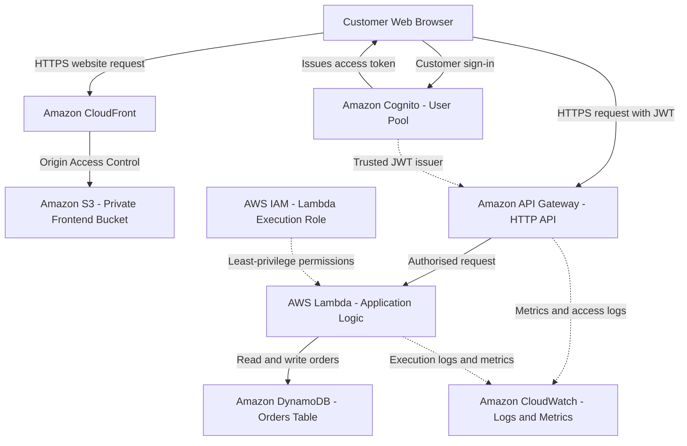

# AWS Solutions Architecture & Technical Design

**Project:** Secure & Scalable Customer Platform on AWS

**Client:** Fictional UK-Based Online Retailer

**Architecture Type:** Serverless, Cloud-Native Application

**Primary AWS Region:** Europe (London) — eu-west-2

**Status:** Proposed Architecture — Not Deployed

---

## 1. Executive Architecture Overview

This architecture proposes a secure, scalable and highly available customer platform for a growing online retailer.

The platform enables customers to authenticate, submit orders and retrieve order information through a web-based application.

A serverless architecture is proposed to reduce infrastructure management, support fluctuating customer demand and provide usage-based pricing.

The solution separates the application into four main layers:

1. Presentation — Customer-facing web application.
2. Identity — Customer authentication and token issuance.
3. Application — API processing and business logic.
4. Data — Persistent order storage.

Security, monitoring and access governance are incorporated across the architecture.

## 2. AWS Architecture Diagram



**Architecture note:** CloudFront is a global content delivery service. The regional application services are proposed for AWS Europe (London).

## 3. AWS Service Selection

| AWS Service | Architectural Role | Business Justification |
| --- | --- | --- |
| Amazon CloudFront | Content delivery | Delivers frontend content through a globally distributed network |
| Amazon S3 | Static frontend storage | Stores website files without maintaining a web server |
| Amazon Cognito | Customer identity | Provides customer authentication and token issuance |
| Amazon API Gateway | API entry point | Routes authenticated requests to application functions |
| AWS Lambda | Application processing | Executes order-management logic without managing servers |
| Amazon DynamoDB | Order database | Stores customer order records using managed NoSQL storage |
| AWS IAM | Service permissions | Restricts which AWS resources application functions can access |
| Amazon CloudWatch | Observability | Provides logs, metrics and operational monitoring |

## 4. Customer Request Workflow

### Step 1 — Website Access

A customer opens the retailer's website.

Amazon CloudFront delivers the frontend application from a private Amazon S3 bucket.

CloudFront Origin Access Control (OAC) is proposed to prevent direct public access to the S3 origin.

### Step 2 — Customer Authentication

Customers authenticate using Amazon Cognito.

The design proposes an OAuth 2.0 authorisation code flow with PKCE for the browser-based application.

After successful authentication, Cognito issues the relevant tokens.

The frontend uses an access token when requesting protected application resources.

### Step 3 — API Authorisation

The browser sends an HTTPS request to Amazon API Gateway with its access token.

API Gateway uses a JWT authoriser configured for the Cognito user pool.

The authoriser validates the token before passing the request to the application.

### Step 4 — Application Processing

AWS Lambda handles the application request.

The function is responsible for:

- Validating incoming order data.
- Identifying the authenticated customer.
- Applying business rules.
- Creating or retrieving order records.
- Returning appropriate API responses.

### Step 5 — Data Storage

Amazon DynamoDB stores persistent order information.

The application retrieves the customer's identity from validated authentication claims rather than trusting a user identifier supplied in the request body.

This allows the application to enforce customer-level access to order records.

### Step 6 — Operational Monitoring

Amazon CloudWatch receives application logs and service metrics.

Monitoring would be configured to support:

- Application error investigation.
- API request monitoring.
- Response latency analysis.
- Service performance visibility.
- Operational alerting.

## 5. Example API Design

| Method | API Route | Purpose | Authentication |
| --- | --- | --- | --- |
| POST | /orders | Submit a customer order | Required |
| GET | /orders | Retrieve the authenticated customer's orders | Required |
| GET | /orders/{orderId} | Retrieve a specific customer order | Required |

The initial scope excludes payments, stock reservation, shipping-provider integrations and administrative order updates.

## 6. Proposed Data Architecture

### DynamoDB Orders Table

**Table Name:** CustomerOrders

| Attribute | Purpose |
| --- | --- |
| userId | Partition key — authenticated customer identifier |
| orderId | Sort key — unique order identifier |
| orderStatus | Current order state |
| createdAt | Order creation timestamp |
| items | Order item details |

Using `userId` as the partition key and `orderId` as the sort key supports the expected access patterns:

- Retrieve a customer's orders.
- Retrieve a specific order belonging to that customer.

The backend must enforce ownership checks using the authenticated identity.

### Capacity Model

DynamoDB on-demand capacity is proposed for the initial workload.

This allows throughput capacity to adapt to demand without requiring fixed read and write capacity provisioning.

Actual scaling behaviour, cost and request patterns must be evaluated before production deployment.

## 7. Identity and Access Management

Two distinct identity mechanisms are required.

### Customer Authentication — Amazon Cognito

Cognito manages customer sign-in and issues authentication tokens.

API Gateway validates the relevant JWT before allowing access to protected API routes.

### AWS Resource Authorisation — AWS IAM

AWS IAM controls permissions between application services.

For example, the Lambda execution role should only permit the necessary DynamoDB actions on the intended orders table, alongside required logging permissions.

The application should not use unrestricted administrator credentials.

**Security principle:** Customer authentication and AWS service permissions serve different purposes and must be designed separately.

## 8. Architecture Decision Records

| ID | Decision | Justification | Trade-Off |
| --- | --- | --- | --- |
| ADR-01 | Serverless architecture | Reduces routine server administration | Managed-service dependence and variable usage costs |
| ADR-02 | CloudFront and private S3 | Efficient frontend delivery with restricted origin access | Requires CDN and caching configuration |
| ADR-03 | Cognito authentication | Managed customer identity capabilities | Identity configuration and pricing considerations |
| ADR-04 | API Gateway and Lambda | Managed API routing and event-driven processing | Function cold starts, quotas and concurrency considerations |
| ADR-05 | DynamoDB on-demand | Flexible scaling for customer order access patterns | NoSQL modelling constraints and variable request costs |
| ADR-06 | CloudWatch monitoring | Centralised service visibility | Logging configuration and ongoing monitoring costs |

## 9. Alternative Technology Considerations

### AWS Lambda versus Amazon EC2

Lambda is preferred for the initial design because request-driven application processing avoids managing persistent application servers.

EC2 could be more appropriate if the application required long-running processes, specialised runtime control or consistently high sustained compute usage.

### Amazon DynamoDB versus Amazon RDS

DynamoDB is preferred for the simplified order-access requirements because the initial data model is well suited to key-based queries.

Amazon RDS could be more appropriate if the application required complex relational queries, multiple transactional relationships or established SQL-based business systems.

These choices would be revisited if the business requirements changed.

## 10. Requirements Traceability

| Requirement | Proposed Architectural Component |
| --- | --- |
| FR-01: Customer web interface | CloudFront and S3 |
| FR-02: Customer authentication | Cognito |
| FR-03: Order submission | API Gateway, Lambda and DynamoDB |
| FR-04: Order tracking | Lambda and DynamoDB |
| FR-05: Persistent order records | DynamoDB |
| FR-06: Operational monitoring | CloudWatch |
| BO-03: Information protection | Cognito, API authorisation and IAM |
| BO-04: Reduced infrastructure administration | Managed serverless services |

## 11. Assumptions and Limitations

This is a proposed design for a fictional customer platform.

The architecture has not been deployed to AWS, and the performance, scalability, availability and security controls have not been independently tested.

Detailed cost modelling, resilience assessment, backup configuration, monitoring thresholds and workload validation will be addressed in the next phase.

## 12. Technical References

- [Amazon CloudFront Origin Access Control](https://docs.aws.amazon.com/AmazonCloudFront/latest/DeveloperGuide/private-content-restricting-access-to-s3.html)
- [API Gateway JWT Authorisers](https://docs.aws.amazon.com/apigateway/latest/developerguide/http-api-jwt-authorizer.html)
- [Amazon Cognito PKCE Authentication](https://docs.aws.amazon.com/cognito/latest/developerguide/using-pkce-in-authorization-code.html)
- [DynamoDB On-Demand Capacity](https://docs.aws.amazon.com/amazondynamodb/latest/developerguide/on-demand-capacity-mode.html)
- [DynamoDB Primary Keys](https://docs.aws.amazon.com/amazondynamodb/latest/developerguide/HowItWorks.CoreComponents.html)
- [API Gateway Monitoring](https://docs.aws.amazon.com/apigateway/latest/developerguide/http-api-monitor.html)
```